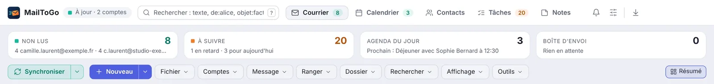
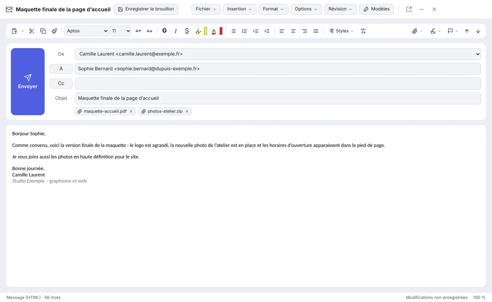
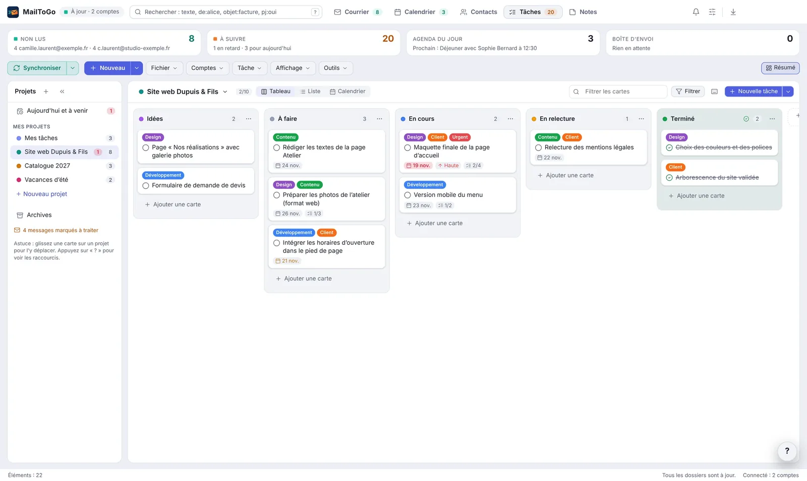
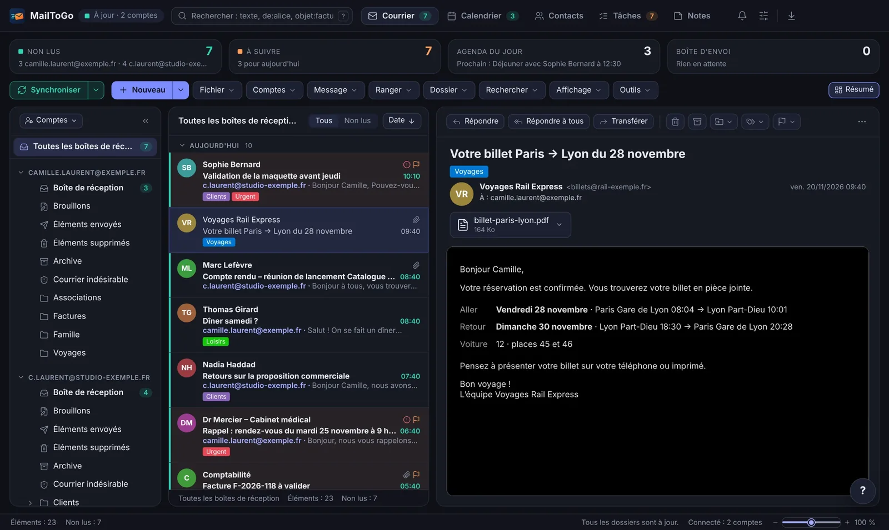
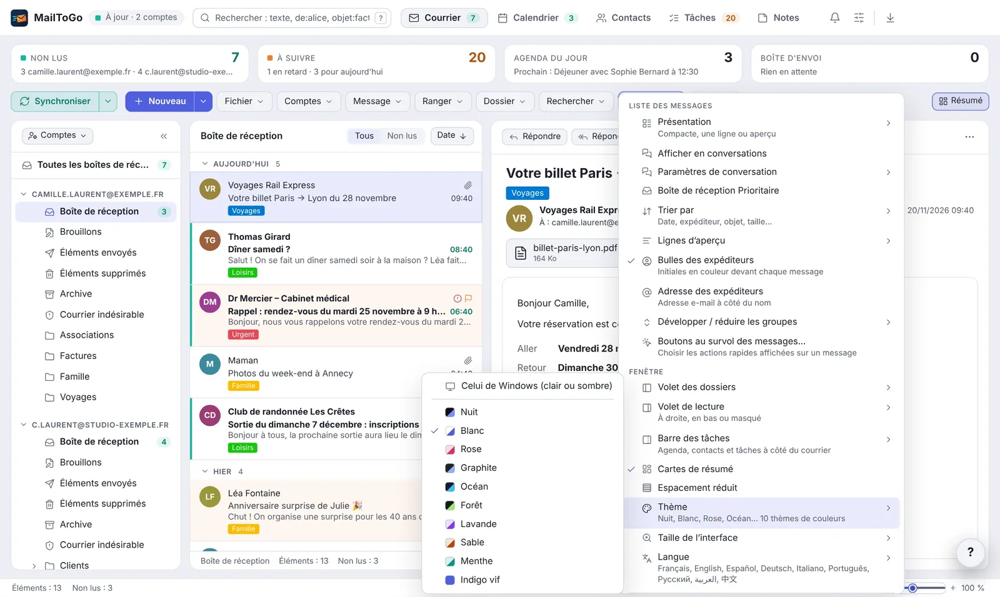

  

<h1 align="center">MailToGo by LeTurfu</h1>

  <b>Tous vos e-mails dans une seule fenêtre. Et ils restent chez vous.</b> 
  La messagerie gratuite pour Windows qui réunit Gmail, Outlook.com et tous vos comptes, 
  avec calendrier, contacts, tâches en tableaux et bloc-notes. Sans abonnement, sans publicité, sans serveur intermédiaire.

  
  
  
  
  

  <a href="https://github.com/dev-leturfu/MailToGo/releases/latest"><b>⬇ Télécharger MailToGo pour Windows</b></a>
  &nbsp;·&nbsp;
  <a href="https://leturfu.com/mailtogo/">Site officiel</a>

<picture>
  <source media="(prefers-color-scheme: dark)" srcset="docs/boite-unifiee-sombre.webp">
  
</picture>

---

## Pourquoi MailToGo ?

| | |
|---|---|
| **Une seule fenêtre pour tout** | Gmail, Outlook.com, Microsoft 365, Yahoo, iCloud, Orange, Free, SFR, La Poste, GMX… Ajoutez autant de comptes que vous voulez et lisez-les ensemble dans une boîte de réception unifiée. |
| **Votre journée organisée** | Courrier, calendrier, contacts, tâches et notes au même endroit, avec un résumé de ce qui compte aujourd'hui. |
| **Vos données restent chez vous** | Aucun serveur MailToGo : vos messages vont directement de votre fournisseur à votre PC. Ni publicité, ni statistiques, ni intelligence artificielle. |
| **Rien ne se perd** | Brouillons enregistrés, annulation de l'envoi, boîte d'envoi qui patiente sans Internet, sauvegarde complète en un fichier. |
| **À votre image** | 10 thèmes clairs ou sombres, 9 langues, une interface simple et rapide. |
| **Toujours à jour** | MailToGo se met à jour tout seul, en un clic, depuis ce dépôt. |

---

## Votre journée en un coup d'œil

En haut de la fenêtre, quatre cartes résument ce qui compte : **messages non lus** compte par compte, **éléments à suivre** (en retard, pour aujourd'hui), **agenda du jour** avec le prochain rendez-vous, et **boîte d'envoi**. Un clic sur une carte vous y emmène.

<picture>
  <source media="(prefers-color-scheme: dark)" srcset="docs/resume-sombre.webp">
  
</picture>

## Une messagerie complète

- **Tous vos comptes** : Gmail et Google Workspace, Outlook.com, Hotmail, Live, Microsoft 365 et tout compte IMAP/SMTP. Saisissez votre adresse, MailToGo trouve les réglages tout seul.
- **Connexion sécurisée** à Google et Microsoft sur leur page officielle : MailToGo ne voit jamais votre mot de passe.
- **Boîte de réception unifiée**, conversations, boîte Prioritaire, catégories en couleur, indicateurs de suivi, importance.
- **Recherche instantanée** par expéditeur, objet ou contenu, dans un dossier, un compte ou partout.
- **Règles et actions rapides** : classez, catégorisez et transférez automatiquement, regroupez plusieurs gestes en un clic, bloquez les expéditeurs indésirables, activez vos réponses d'absence.
- **Signatures, modèles, papier à lettres**, accusés de lecture, impression et enregistrement en PDF.
- **Notifications Windows** pour chaque nouveau message, et compteur sur l'icône de la barre des tâches.

## Écrire sans rien perdre

<picture>
  <source media="(prefers-color-scheme: dark)" srcset="docs/redaction-sombre.webp">
  
</picture>

- Bouton **« Enregistrer le brouillon »**, et une question avant de fermer un message non envoyé.
- **Brouillons modifiables** directement dans le volet de lecture.
- **Annuler l'envoi** : 10 secondes pour rattraper un message parti trop vite (réglable jusqu'à 5 minutes).
- **Glissez un fichier** dans le message : joint en pièce jointe ou inséré dans le texte, au choix.
- **Sans Internet**, vos messages attendent dans la boîte d'envoi et partent dès le retour de la connexion.

## Vos projets en tableaux

<picture>
  <source media="(prefers-color-scheme: dark)" srcset="docs/taches-sombre.webp">
  
</picture>

Organisez votre travail comme sur un tableau de cartes : **plusieurs projets**, une colonne par étape, des **étiquettes en couleur**, des **échéances**, une priorité et des **listes d'étapes**. Les tâches en retard sont signalées, et un message à traiter devient une carte d'un simple **glisser-déposer**. Vues Tableau, Liste ou Calendrier.

## Un vrai bloc-notes

<picture>
  <source media="(prefers-color-scheme: dark)" srcset="docs/notes-sombre.webp">
  
</picture>

Blocs-notes, sections, pages et sous-pages, comme dans un classeur. **Titres, listes, tableaux, images, fichiers et liens**, balises **À faire, Important, Question**, recherche dans toutes les notes, **historique des versions** et export en PDF ou en HTML.

## Calendrier et contacts

| Calendrier | Contacts |
|---|---|
| <picture><source media="(prefers-color-scheme: dark)" srcset="docs/calendrier-sombre.webp"></picture> | <picture><source media="(prefers-color-scheme: dark)" srcset="docs/contacts-sombre.webp"></picture> |
| Vues jour, semaine de travail, semaine, mois et planification. Rendez-vous répétitifs, réunions, **rappels avec notification**, import et export `.ics`. | Carnet d'adresses complet en vues Personnes, Cartes, Liste ou Téléphone. Import `.vcf`, **saisie automatique** des destinataires, écrire ou planifier une réunion en un clic. |

## Clair ou sombre, à votre goût

**10 thèmes** (Nuit, Graphite, Océan, Forêt, Blanc, Rose, Lavande, Sable, Menthe, Indigo vif), ou celui de Windows qui passe tout seul du clair au sombre. Les messages peuvent aussi s'afficher sur fond sombre.

| Thème clair (Blanc) | Thème sombre (Nuit) |
|---|---|
|  |  |
|  |  |

Tout se règle dans le menu **Affichage** : présentation de la liste, conversations, volet de lecture, cartes de résumé, taille de l'interface, thème et langue.

<picture>
  <source media="(prefers-color-scheme: dark)" srcset="docs/themes-sombre.webp">
  
</picture>

## Dans votre langue

**Français, English, Español, Deutsch, Italiano, Português, Русский, العربية** (affichée de droite à gauche) **et 中文**. Par défaut, MailToGo prend la langue de Windows ; l'installateur aussi.

## Vos données restent chez vous

- **Aucun serveur MailToGo** : tout est stocké sur votre PC. Le développeur ne reçoit, ne voit et ne conserve aucune de vos données.
- **Mots de passe et autorisations chiffrés** par Windows ; connexions toujours chiffrées.
- **Ni publicité, ni statistiques d'utilisation, ni intelligence artificielle** qui lirait vos messages.
- Images à distance et **pixels de suivi** bloquables dans les options.
- Accès Microsoft limité à la messagerie : ni votre calendrier, ni vos contacts, ni vos fichiers.

Tous les détails : [règles de confidentialité](https://leturfu.com/mailtogo/confidentialite.html).

## Vous quittez Outlook ? Emportez tout

Au premier lancement, MailToGo propose d'importer **en une fois** ce que vous avez dans Outlook classique : calendrier, contacts, tâches, notes, catégories et leurs couleurs, règles, signatures et liste de vos comptes. Rien n'est modifié dans Outlook.

## Changer de PC sans rien perdre

**Fichier > Exporter toute la configuration** : comptes, réglages, calendrier, contacts, tâches, notes, règles et signatures dans un seul fichier `.mtgbackup`. Sur le nouveau PC, **Fichier > Importer une configuration**, et vos messages se retéléchargent tout seuls. Les mots de passe n'y figurent que si vous protégez la sauvegarde par un mot de passe (chiffrement AES-256).

## Toujours à jour, en un clic

MailToGo vérifie au démarrage, puis une fois par jour, si une nouvelle version est publiée ici. Il vous la propose avec la liste des nouveautés ; **en un clic**, il la télécharge, vérifie son intégrité, l'installe et se rouvre. Vos comptes, messages et réglages sont conservés.

Recherche manuelle : **Outils > Rechercher des mises à jour**. Désactivable dans **Options > Options avancées > Mises à jour**.

---

## Installer MailToGo

1. **Téléchargez** l'installateur `MailToGo-Setup-….exe` de la [dernière version](https://github.com/dev-leturfu/MailToGo/releases/latest) (rubrique *Assets*).
2. **Lancez-le** : il s'affiche dans la langue de Windows, rien d'autre à installer.
3. **Ajoutez vos comptes** : saisissez votre adresse, MailToGo s'occupe du reste. Pour Gmail et Outlook.com, connectez-vous sur la page officielle de Google ou de Microsoft.

Gratuit · Windows 10 et 11 (64 bits) · Aucune inscription · Aucune carte bancaire

  <a href="https://github.com/dev-leturfu/MailToGo/releases/latest"><b>⬇ Télécharger MailToGo</b></a>

## Questions fréquentes

<b>MailToGo est-il vraiment gratuit ?</b>

Oui : gratuit, sans abonnement et sans publicité. Il ne vit pas de vos données, il n'en reçoit aucune.

<b>Mes e-mails passent-ils par un serveur MailToGo ?</b>

Non. MailToGo n'a pas de serveur : il se connecte directement à votre fournisseur (Gmail, Outlook.com…) et garde une copie sur votre PC pour un affichage rapide, même sans Internet.

<b>MailToGo connaît-il mon mot de passe Gmail ou Outlook.com ?</b>

Non. Vous vous connectez sur la page officielle de Google ou de Microsoft ; MailToGo reçoit seulement une autorisation, chiffrée sur votre PC, que vous pouvez retirer à tout moment.

<b>Que se passe-t-il si j'envoie un message sans Internet ?</b>

Il attend dans la boîte d'envoi et part tout seul dès que la connexion revient.

<b>Comment changer le thème ou la langue ?</b>

Menu **Affichage > Thème** et **Affichage > Langue** : le changement est immédiat.

<b>Comment supprimer mes données ?</b>

Retirez le compte dans **Comptes > Paramètres des comptes** : sa copie locale et son autorisation sont effacées. Détails dans les [règles de confidentialité](https://leturfu.com/mailtogo/confidentialite.html#conservation).

## Bon à savoir

- Windows 10 et 11 (64 bits) uniquement.
- Comptes IMAP/SMTP : pas de POP3 ni d'Exchange en direct (EWS). Pour Microsoft 365, l'accès IMAP doit être autorisé par l'administrateur.
- Le calendrier, les contacts, les tâches et les notes sont gardés sur le PC, sans synchronisation avec Google Agenda ou Outlook.com : pensez à la sauvegarde.
- Les réponses automatiques et les règles s'appliquent pendant que MailToGo est ouvert.
- L'import Outlook demande Outlook classique (pas le nouvel Outlook).

*Captures réalisées avec des données d'exemple : tous les noms, adresses et contenus sont fictifs.*

## Licence

© 2026 [LeTurfu.com](https://leturfu.com) – Tous droits réservés. MailToGo est gratuit à télécharger et à utiliser ; le code source n'est pas public. MailToGo n'est ni affilié à Google ou à Microsoft, ni approuvé par eux.
