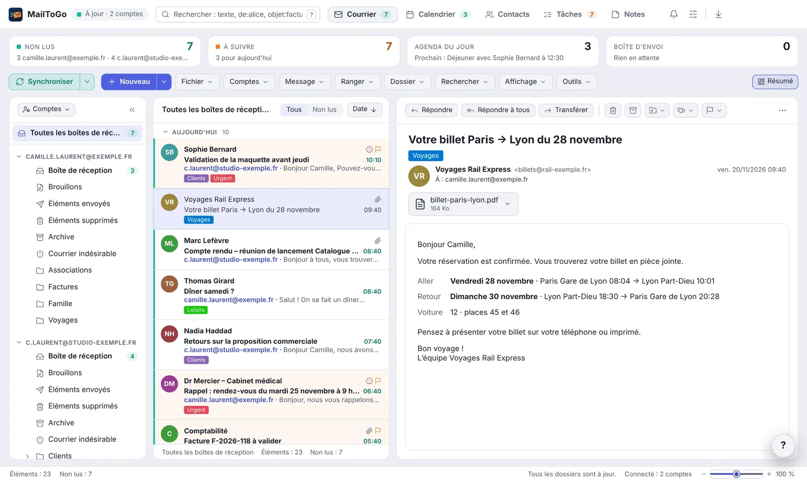
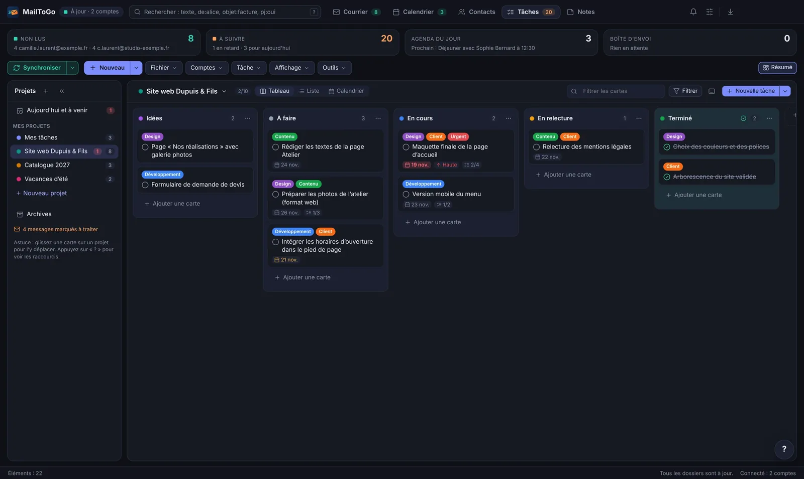
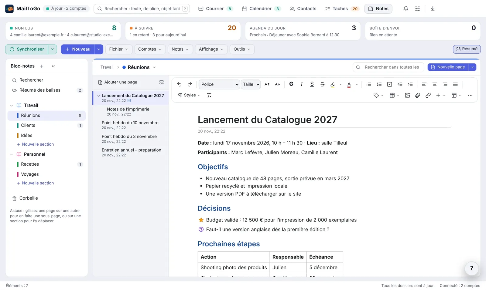
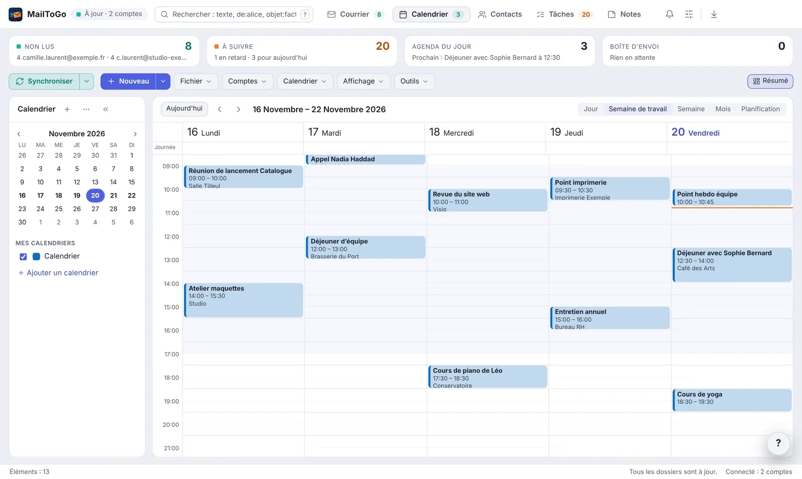
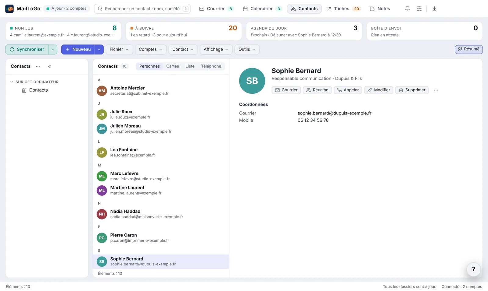

# MailToGo by LeTurfu

<picture>
  <source media="(prefers-color-scheme: dark)" srcset="docs/boite-unifiee-sombre.webp">
  
</picture>

Logiciel de messagerie pour Windows 10/11 : Gmail, Outlook.com, Microsoft 365 et tous les comptes IMAP dans une seule fenêtre, avec calendrier, contacts, tâches en tableaux et bloc-notes.
Gratuit, en 9 langues, sans serveur intermédiaire : vos e-mails vont directement de votre fournisseur à votre PC.

## Installer

Télécharger l'installateur `MailToGo-Setup-….exe` de la [dernière version](https://github.com/dev-leturfu/MailToGo/releases/latest) (rubrique *Assets*), puis le lancer. L'installateur s'affiche dans la langue de Windows ; rien d'autre à installer.

Déjà installé ? Inutile de revenir ici : MailToGo propose tout seul les nouvelles versions (voir ci-dessous).

Au premier lancement, MailToGo propose d'ajouter un compte (les réglages sont trouvés automatiquement) ou d'importer, une seule fois, ce que vous aviez dans Outlook.

## Mises à jour

MailToGo vérifie au démarrage, puis une fois par jour, si une nouvelle version est publiée dans les [Releases](https://github.com/dev-leturfu/MailToGo/releases) de ce dépôt. Il la propose avec la liste des nouveautés : en un clic, il la télécharge, contrôle sa taille et son empreinte SHA-256, l'installe et se rouvre. Comptes, messages et réglages sont conservés.

- Recherche manuelle : **Outils > Rechercher des mises à jour**, ou la bulle **?** en bas de la fenêtre.
- Désactiver la vérification automatique : **Options > Options avancées > Mises à jour**.
- « Ignorer cette version » ne propose plus cette version-là, seulement les suivantes.

## Clair ou sombre

10 thèmes de couleurs, ou celui de Windows (clair ou sombre automatiquement) : menu **Affichage > Thème**. Les messages peuvent aussi s'afficher sur fond sombre.

| Thème clair (Blanc) | Thème sombre (Nuit) |
|---|---|
|  |  |
|  |  |

## Organisation de l'interface

- Barre du haut : nom des comptes et état de la synchronisation, recherche, les 5 modules (Courrier, Calendrier, Contacts, Tâches, Notes) avec leur compteur, rappels et options.
- **Cartes de résumé** : Non lus, À suivre, Agenda du jour, Boîte d'envoi. Un clic sur une carte y mène ; le bouton **Résumé** les masque.
- **Menus** : Fichier, Comptes, Message, Ranger, Dossier, Rechercher, Affichage, Outils (ils s'adaptent au module ouvert).
- Volet des dossiers, liste des messages et volet de lecture, redimensionnables ; aide avec **F1**.

<picture>
  <source media="(prefers-color-scheme: dark)" srcset="docs/resume-sombre.webp">
  
</picture>

## Fonctions

- **Comptes** : Gmail et Google Workspace, Outlook.com, Hotmail, Live, Microsoft 365, Yahoo, iCloud, Orange, Free, SFR, La Poste, GMX et tout compte IMAP/SMTP. Détection automatique des serveurs ; connexion Google et Microsoft sur leur page officielle (OAuth 2.0 avec PKCE).
- **Courrier** : boîte de réception unifiée ou par compte, conversations, boîte Prioritaire, catégories en couleur, indicateurs de suivi, importance, signatures, papier à lettres, modèles, accusés de lecture, impression et enregistrement en PDF.
- **Rédaction sans perte** : bouton « Enregistrer le brouillon », question avant de fermer un message non envoyé, brouillons modifiables directement dans le volet de lecture. Un fichier glissé dans le message est joint ou inséré dans le texte, au choix.
- **Annuler l'envoi** : 10 secondes par défaut (de 5 secondes à 5 minutes). Sans Internet, les messages attendent dans la boîte d'envoi et partent dès le retour de la connexion.
- **Recherche** rapide par expéditeur, objet ou contenu, dans un dossier, un compte ou partout, et dossiers de recherche.
- **Règles et actions rapides** : classement automatique, catégories, transferts, expéditeurs bloqués et approuvés, réponses automatiques d'absence, actions rapides en un clic.
- **Calendrier** : vues jour, semaine de travail, semaine, mois et planification ; rendez-vous répétitifs, réunions, rappels avec notification Windows, import et export `.ics`.
- **Contacts** : vues Personnes, Cartes, Liste et Téléphone, import `.vcf`, saisie automatique des destinataires.
- **Tâches en tableaux** : plusieurs projets, colonnes par étape, cartes avec étiquettes en couleur, échéances, priorité, listes d'étapes, tâches en retard signalées ; un message à traiter devient une carte par glisser-déposer ; vues Tableau, Liste et Calendrier.
- **Bloc-notes** : blocs-notes, sections, pages et sous-pages ; titres, listes, tableaux, images, fichiers et liens ; balises À faire, Important, Question… ; recherche dans toutes les notes ; historique des versions ; export PDF ou HTML.
- **Affichage** : 10 thèmes (Nuit, Graphite, Océan, Forêt, Blanc, Rose, Lavande, Sable, Menthe, Indigo vif) ou celui de Windows, messages sur fond sombre, taille de l'interface, zoom, correcteur orthographique de Windows.
- **9 langues** : français, English, español, Deutsch, italiano, português, русский, العربية (de droite à gauche) et 中文. Par défaut, celle de Windows.
- **Hors connexion** : les messages restent lisibles sur le PC ; mode « Travailler hors connexion ».
- **Sauvegarde** : toute la configuration (comptes, réglages, calendrier, contacts, tâches, notes, règles, signatures) dans un fichier `.mtgbackup` pour passer à un autre PC. Mots de passe inclus seulement si la sauvegarde est protégée par un mot de passe (AES-256-GCM).
- **Import Outlook** (une seule fois) : calendrier, contacts, tâches, notes, catégories, règles, signatures et liste des comptes. Rien n'est modifié dans Outlook.
- **Notifications** Windows pour les nouveaux messages et les rappels, compteur sur l'icône de la barre des tâches.

### En images

| Tâches | Notes |
|---|---|
| <picture><source media="(prefers-color-scheme: dark)" srcset="docs/taches-sombre.webp"></picture> | <picture><source media="(prefers-color-scheme: dark)" srcset="docs/notes-sombre.webp"></picture> |
| **Calendrier** | **Rédaction** |
| <picture><source media="(prefers-color-scheme: dark)" srcset="docs/calendrier-sombre.webp"></picture> | <picture><source media="(prefers-color-scheme: dark)" srcset="docs/redaction-sombre.webp"></picture> |
| **Contacts** | **Affichage et thèmes** |
| <picture><source media="(prefers-color-scheme: dark)" srcset="docs/contacts-sombre.webp"></picture> | <picture><source media="(prefers-color-scheme: dark)" srcset="docs/themes-sombre.webp"></picture> |

*Captures réalisées avec des données d'exemple : tous les noms, adresses et contenus sont fictifs.*

## Vos données

- Aucun serveur MailToGo : tout est stocké sur votre PC, dans `%APPDATA%\MailToGo`. Le développeur ne reçoit aucune de vos données.
- Mots de passe et autorisations chiffrés par Windows (DPAPI) ; connexions chiffrées (TLS).
- Ni publicité, ni statistiques d'utilisation, ni intelligence artificielle.
- Détails : [règles de confidentialité](https://leturfu.com/mailtogo/confidentialite.html) et [conditions d'utilisation](https://leturfu.com/mailtogo/conditions-utilisations.html).

## Limites connues

- Windows 10 et 11 (64 bits) uniquement.
- Comptes IMAP/SMTP seulement : pas de POP3 ni d'Exchange en direct (EWS). Pour Microsoft 365, l'accès IMAP doit être autorisé par l'administrateur.
- Le calendrier, les contacts, les tâches et les notes sont gardés sur le PC : ils ne sont pas synchronisés avec Google Agenda ou Outlook.com. Pensez à la sauvegarde (Fichier > Exporter toute la configuration).
- Les réponses automatiques et les règles s'appliquent pendant que MailToGo est ouvert.
- L'import Outlook demande Outlook classique installé sur le PC (pas le nouvel Outlook).

## Licence

© 2026 [LeTurfu.com](https://leturfu.com) – Tous droits réservés. MailToGo est gratuit à télécharger et à utiliser ; le code source n'est pas public. MailToGo n'est ni affilié à Google ou à Microsoft, ni approuvé par eux.
